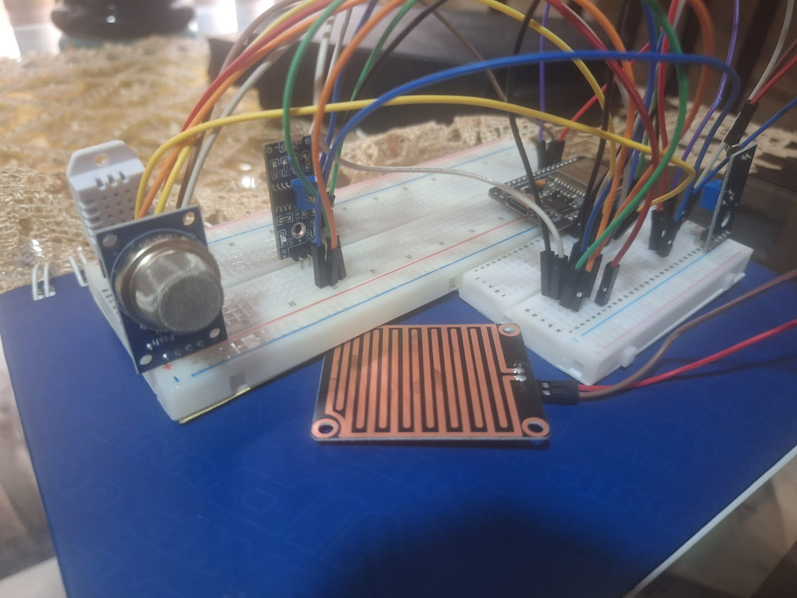
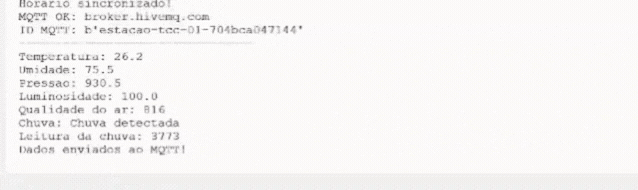
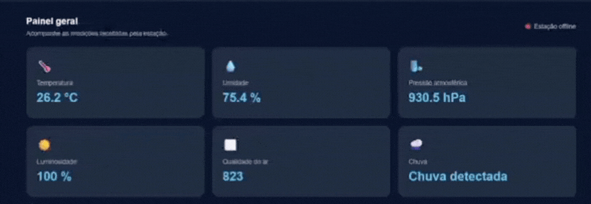
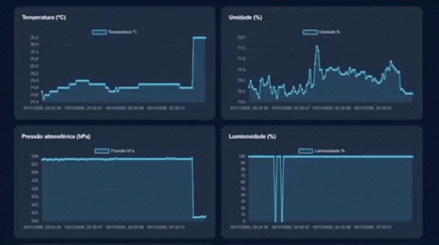

# Estação Meteorológica Inteligente

Sistema de monitoramento ambiental desenvolvido com **Internet das Coisas (IoT)**, utilizando ESP32, sensores eletrônicos, comunicação MQTT e um dashboard web para visualização de dados.

Projeto acadêmico desenvolvido por estudantes da **Universidade Paulista (UNIP)**, com o objetivo de aplicar conceitos de IoT e Cidades Inteligentes na coleta e disponibilização de informações ambientais.

LINK DO VÍDEO: https://youtu.be/X0IBz682_OU
---

## Sobre o projeto

A Estação Meteorológica Inteligente realiza a coleta de informações ambientais por meio de sensores conectados a um ESP32.

Os dados são processados pelo microcontrolador, enviados pela rede Wi-Fi utilizando o protocolo MQTT e recebidos por um backend desenvolvido em Python.

Posteriormente, as informações são armazenadas em um banco de dados SQLite e disponibilizadas em uma interface web para consulta e acompanhamento das medições.



### Objetivos

- Monitorar diferentes variáveis ambientais.
- Aplicar conceitos de Internet das Coisas.
- Integrar hardware, comunicação e desenvolvimento web.
- Armazenar e consultar dados históricos.
- Desenvolver uma solução relacionada ao conceito de Cidades Inteligentes.

---

## Arquitetura do sistema

O projeto é dividido em cinco etapas principais:

```text
┌──────────────────────────────┐
│           SENSORES           │
│                              │
│ DHT22 | BMP280 | LDR         │
│ MQ-135 | Sensor de chuva     │
└──────────────┬───────────────┘
               │
               ▼
┌──────────────────────────────┐
│            ESP32             │
│         MicroPython          │
│                              │
│ Leitura e organização dos    │
│ dados em formato JSON        │
└──────────────┬───────────────┘
               │
               ▼
┌──────────────────────────────┐
│        WI-FI / MQTT          │
│                              │
│       Broker HiveMQ          │
└──────────────┬───────────────┘
               │
               ▼
┌──────────────────────────────┐
│       BACKEND PYTHON         │
│                              │
│       Flask + MQTT           │
│       Validação dos dados    │
└──────────────┬───────────────┘
               │
               ▼
┌──────────────────────────────┐
│         BANCO SQLITE         │
│                              │
│       Armazenamento          │
└──────────────┬───────────────┘
               │
               ▼
┌──────────────────────────────┐
│        DASHBOARD WEB         │
│                              │
│      HTML + CSS + JS         │
│      Gráficos e histórico    │
└──────────────────────────────┘
```

---

## Hardware utilizado

| Componente | Função |
|---|---|
| ESP32 | Microcontrolador principal |
| DHT22 | Medição de temperatura e umidade |
| BMP280 | Medição de pressão atmosférica e temperatura |
| LDR | Detecção de luminosidade |
| MQ-135 | Leitura relacionada à qualidade do ar |
| Sensor analógico de chuva | Detecção de presença de água |

### Mapeamento de pinos

Pinagem de referência configurada no firmware:

| Componente | GPIO |
|---|---|
| BMP280 SDA | GPIO 21 |
| BMP280 SCL | GPIO 22 |
| DHT22 | GPIO 4 |
| LDR | GPIO 34 |
| MQ-135 | GPIO 35 |
| Sensor de chuva | GPIO 32 |

---

## Tecnologias utilizadas

### Firmware e hardware
- ESP32 
- MicroPython
- Thonny IDE
- Sensores eletrônicos
- Comunicação I²C
- Leitura analógica ADC



### Comunicação
- Wi-Fi
- MQTT
- HiveMQ Broker
- JSON

### Backend
- Python
- Flask
- Cliente MQTT
- SQLite

### Frontend
- HTML5
- CSS3
- JavaScript
- Chart.js
- Leaflet / OpenStreetMap, quando habilitado na versão do dashboard.



---

## Comunicação MQTT

O ESP32 publica periodicamente as informações coletadas pelos sensores em um broker MQTT.

**Configuração utilizada:**

| Parâmetro | Valor |
|---|---|
| Broker | `broker.hivemq.com` |
| Porta | `1883` |
| Protocolo | MQTT |
| Intervalo de envio | 10 segundos |
| Identificação da estação | `estacao-tcc-01` |

**Tópico MQTT:**

```text
cidadesinteligentes/estacao-tcc-01/telemetria
```

As informações são organizadas em formato JSON.

Exemplo ilustrativo:

```json
{
  "estacao": "estacao-tcc-01",
  "temp_dht": 24.5,
  "umidade": 65,
  "pressao": 933,
  "luz_pct": 80,
  "mq_bruto": 320,
  "chuva_bruto": 4095,
  "chuva_detectada": false,
  "chuva_status": "Sem chuva"
}
```

Os valores apresentados são apenas exemplos de estrutura, não medições fixas do sistema.

---

## Backend e armazenamento

O backend foi desenvolvido em Python utilizando Flask e um cliente MQTT.

Suas principais responsabilidades são:

- Receber as mensagens publicadas pelo ESP32.
- Interpretar os dados recebidos em JSON.
- Realizar verificações dos dados.
- Armazenar as medições no SQLite.
- Disponibilizar informações por meio de endpoints HTTP.

### Endpoints

| Rota | Descrição |
|---|---|
| `/dados` | Retorna a medição mais recente e informações da estação. |
| `/historico` | Retorna os registros armazenados no banco de dados. |



### Banco de dados

O projeto utiliza SQLite para armazenar as medições.

Arquivo principal:

```text
estacao.db
```

Tabela principal:

```text
medicoes
```

A estrutura utilizada registra o identificador, o timestamp e os dados de telemetria recebidos.

---

## Dashboard

A interface web permite acompanhar as informações coletadas pela estação meteorológica.

Entre os recursos previstos ou disponíveis, conforme a versão executada:

- Visualização de temperatura.
- Acompanhamento da umidade.
- Monitoramento da pressão atmosférica.
- Indicador de luminosidade.
- Leitura relacionada à qualidade do ar.
- Estado do sensor de chuva.
- Gráficos históricos.
- Tabela de medições armazenadas.

O Chart.js é utilizado para representar graficamente a evolução das medições.


---

## Como executar o projeto

### 1. Preparar o ESP32

- Instale o firmware MicroPython compatível com o ESP32.
- Conecte os sensores de acordo com a pinagem da montagem.
- Abra o firmware no Thonny.
- Configure as credenciais da rede Wi-Fi no código.

Exemplo:

```python
WIFI_SSID = "NOME_DA_REDE"
WIFI_SENHA = "SUA_SENHA"
```

Execute o firmware no ESP32 para iniciar a coleta e publicação dos dados.

### 2. Preparar o backend

Execute o arquivo principal do backend:

```bash
python app.py
```

O nome do arquivo pode variar conforme a organização do repositório.

### 3. Executar o dashboard

Abra os arquivos do frontend por meio de um servidor HTTP local.

```javascript
const API = "http://127.0.0.1:5000/dados";
```

Para o histórico:

```javascript
const API_HISTORICO = "http://127.0.0.1:5000/historico";
```

Com o ESP32, o backend e o dashboard em execução, o sistema poderá apresentar as informações recebidas e armazenadas.


## Contexto acadêmico

Projeto desenvolvido com foco na aplicação prática de conceitos de:

- Internet das Coisas (IoT).
- Sistemas embarcados.
- Redes e protocolos de comunicação.
- Desenvolvimento de aplicações web.
- Banco de dados.
- Cidades Inteligentes.
- Monitoramento ambiental.

---

**Universidade Paulista — UNIP | 2026**
